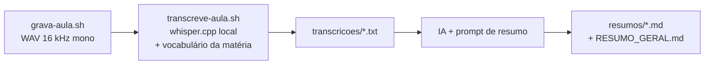

# Transcrição e Resumo de Aulas

Grave a aula, transcreva em português **no seu próprio computador** e gere um resumo com IA.
Sem assinatura, sem enviar o áudio para a nuvem.

- **Gravação:** um comando, com menu para escolher a matéria.
- **Transcrição:** [whisper.cpp](https://github.com/ggml-org/whisper.cpp), rodando localmente, com
  aceleração opcional pela GPU (Vulkan).
- **Vocabulário por matéria:** uma lista de termos técnicos que ajuda o modelo a acertar o jargão
  da disciplina.
- **Resumo:** um prompt pronto para usar com Claude, ChatGPT ou Gemini.



## Como fica organizado

```
~/Aulas/
└── Estatística/
    ├── vocabulario.txt         # termos técnicos da matéria (opcional)
    ├── audios/2026-09-17_1930.wav
    ├── transcricoes/2026-09-17_1930.txt
    └── resumos/
        ├── 2026-09-17_1930.md
        └── RESUMO_GERAL.md     # um resumo cumulativo para revisar para a prova
```

## Instalação (Linux)

Pré-requisitos: `git`, `cmake`, `make`, um compilador C++ e `arecord` (pacote `alsa-utils`).

```bash
git clone https://github.com/MayKobayashi/transcricao-de-aulas
cd transcricao-de-aulas

# Compila o whisper.cpp e baixa o modelo "medium" (~1,5 GB)
./instalar.sh            # só CPU
./instalar.sh --vulkan   # com GPU via Vulkan (precisa de vulkan-headers e do driver da placa)

# Suas matérias, uma por linha
cp materias.exemplo.txt materias.txt
nano materias.txt
```

Opcional: coloque a pasta no `PATH` para usar os comandos de qualquer lugar.

```bash
echo 'export PATH="$PATH:'"$PWD"'"' >> ~/.bashrc   # ou ~/.zshrc
```

## Uso

```bash
# 1. Grave (Ctrl+C para parar)
grava-aula.sh                 # menu com as matérias
grava-aula.sh "Estatística"   # ou direto

# 2. Transcreva
transcreve-aula.sh ~/Aulas/Estatística/audios/2026-09-17_1930.wav

# 3. Resuma: abra prompts/resumo_de_aula.md, cole na sua IA com o .txt gerado
#    e salve o resultado em ~/Aulas/<matéria>/resumos/
```

### Vocabulário por matéria

Crie `~/Aulas/<matéria>/vocabulario.txt` com os termos técnicos separados por vírgula. Exemplos em
[`exemplos/vocabularios/`](exemplos/vocabularios/). O texto é passado ao whisper como prompt inicial
(`--prompt` + `--carry-initial-prompt`). Nos testes, isso corrigiu erros como "joinha" → "join" e
"data frame" → "DataFrame".

### Configuração

Tudo tem um padrão, mas pode ser trocado por variáveis de ambiente:

| Variável | Padrão | Para quê |
|---|---|---|
| `AULAS_DIR` | `~/Aulas` | Onde ficam as pastas das matérias |
| `WHISPER_DIR` | `~/ferramentas/whisper.cpp` | Onde o whisper.cpp foi instalado |
| `MODELO` | `$WHISPER_DIR/models/ggml-medium.bin` | Modelo usado na transcrição |
| `LISTA_MATERIAS` | `materias.txt` (ao lado do script) | Lista do menu de gravação |

## Escolhas e testes

Testado num notebook com 16 núcleos, 16 GB de RAM e GPU integrada AMD, num áudio de aula em
português:

| Configuração | Velocidade | Qualidade | Decisão |
|---|---|---|---|
| `medium`, CPU | base (60 s) | boa | ok, mas lento |
| **`medium` + Vulkan (GPU)** | **~3x mais rápido (20 s)** | **igual** | **usada** |
| `medium` quantizado (q5_0) | ~10% mais rápido | pior num trecho ambíguo | descartada |
| `medium` com beam 1 (greedy) | ~35% mais rápido | pior | descartada |
| `large-v3-turbo` q5_0 | igual ao medium com GPU | inventou termos no português técnico | descartada |

Com GPU, uma aula de 1h30 leva cerca de 30 minutos para transcrever.

## Privacidade e respeito

- Peça autorização ao professor antes de gravar a aula.
- O áudio e a transcrição ficam só no seu computador. O resumo depende da IA que você escolher:
  se não quiser enviar o texto para a nuvem, use um modelo local.
- O `.gitignore` já impede que áudios `.wav` e a sua `materias.txt` sejam versionados.

## Licença

[MIT](LICENSE). Feito por [Mayumi Kobayashi](https://github.com/MayKobayashi).
